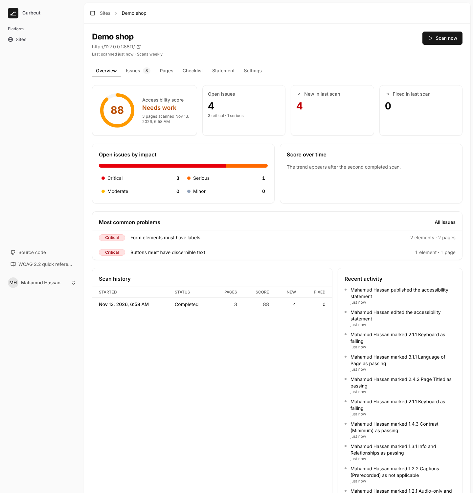
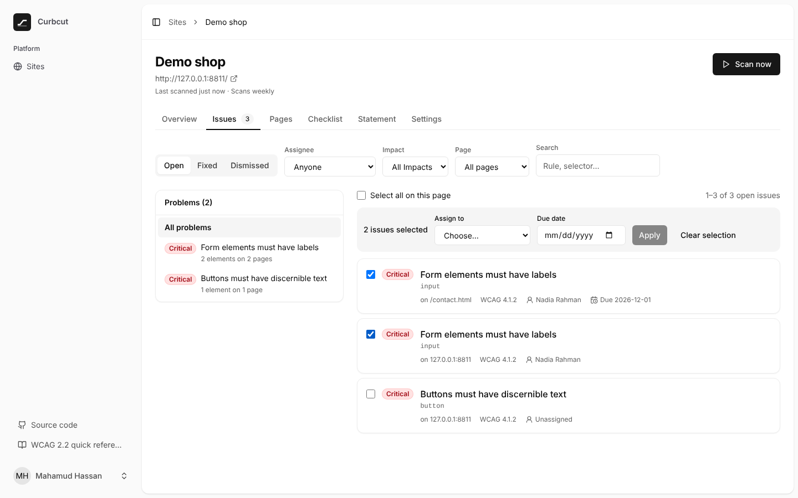
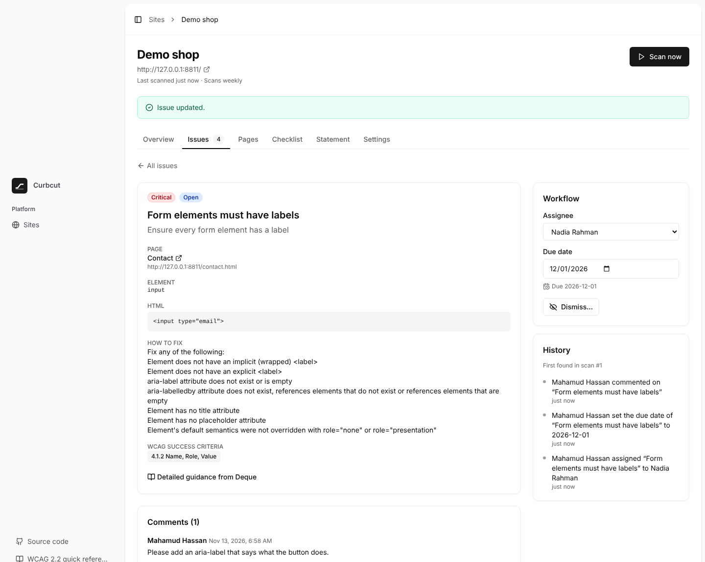
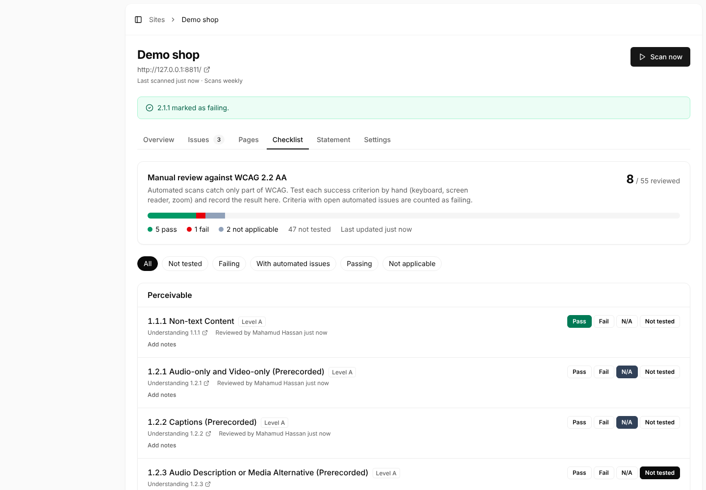
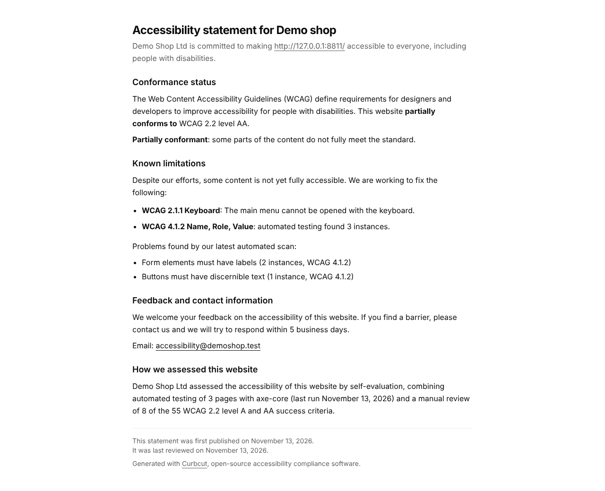

<div align="center">

# Curbcut

**Find, fix and prove web accessibility. Open source and self-hosted.**

Curbcut scans your websites against WCAG 2.2 AA with [axe-core](https://github.com/dequelabs/axe-core), tracks every issue from the day it appears to the day it is fixed, and keeps that history on your own server.

[](https://github.com/mahamud894/curbcut/actions/workflows/tests.yml)
[](LICENSE)




</div>

> **Status:** early development. Scanning, issue tracking, the team workflow, the WCAG checklist and accessibility statements work today. See the [roadmap](#roadmap) for what comes next.

## Why Curbcut?

Since **28 June 2025** the [European Accessibility Act](https://ec.europa.eu/social/main.jsp?catId=1202) requires online shops, banks, transport and many other services sold to people in the EU to be accessible. Similar rules exist in the US (ADA), the UK, Canada and elsewhere.

Most teams have the same problem: free checkers test one page at a time, and the platforms that monitor whole sites cost thousands per year. Curbcut is a free, self-hosted alternative that you run on your own infrastructure, so your data never leaves it.

The name comes from the **curb cut**, the small ramp cut into a pavement kerb. It was made for wheelchair users and ended up helping everyone with a pram, a suitcase or a bike. Accessible websites work the same way.

## Features

**Available now**

- **Whole-site scanning.** Finds pages from your sitemap (including sitemap indexes) or by following links, then checks every page in headless Chrome with axe-core against WCAG 2.0, 2.1 and 2.2 A/AA.
- **Change tracking between scans.** Each problem gets a stable fingerprint, so every scan tells you exactly what is **new**, what is **fixed** and what came back.
- **Accessibility score and trend.** A simple, documented 0–100 score per site and its history over time.
- **Issue explorer.** Issues grouped by problem and page, filterable by impact, page, status and text, each with the failing element, the WCAG success criterion and how to fix it.
- **Scheduled scans.** Daily or weekly scans run automatically; manual scans are one click away.
- **Team workflow.** Add colleagues to a site, assign issues one by one, in bulk or for a whole problem at once, set due dates, discuss in comments and get an email when something is assigned to you.
- **Dismiss with a reason.** Mark false positives or accepted risks with a justification. Dismissed issues stay dismissed on later scans and don't count towards the score.
- **Manual WCAG 2.2 checklist.** All 55 level A and AA success criteria, each with pass, fail or not applicable, notes and evidence, the reviewer and date, links to the W3C Understanding docs, and the open automated issues for that criterion.
- **Accessibility statement.** Generated from the checklist and the latest scan, following the structure of the EU model statement: conformance status, known limitations, feedback and contact, enforcement procedure and how the site was assessed. Publish it as a public page that updates itself.
- **Audit trail.** Every assignment, dismissal, comment, checklist result and statement change is recorded with who did it and when.
- **Safe by default.** Private and local network addresses are blocked unless you allow them, to prevent server-side request forgery.
- **Accessible itself.** Curbcut's own screens are checked with axe-core and pass its WCAG 2.2 AA and best-practice rules.

| Issue list with bulk actions | Issue workflow |
| --- | --- |
|  |  |

| WCAG checklist | Public accessibility statement |
| --- | --- |
|  |  |

## Roadmap

- [x] **Phase 1 — Scan and track:** site management, page discovery, axe-core scanner, new/fixed comparison, score, dashboard, scheduled scans
- [x] **Phase 2 — Compliance workflow:** site members, assign issues with due dates and comments, dismiss with justification, manual WCAG 2.2 checklist, accessibility statement generator with a public page, audit trail
- [ ] **Phase 3 — Ready for teams:** PDF audit reports, organisations and agency mode with many clients, one-command Docker install, documentation site
- [ ] **Phase 4 — Developer workflow:** GitHub Action that fails pull requests on new issues, REST API, optional AI fix suggestions, translations

## How it works

```
┌────────────┐   queue job   ┌──────────────┐  JSON lines  ┌───────────────────────────┐
│  Laravel   │ ────────────► │  ScanRunner  │ ◄─────────── │ scanner/scan.mjs (Node)   │
│  web app   │               │  (PHP)       │  per page    │ Playwright + Chrome +     │
└────────────┘               └──────┬───────┘              │ axe-core                  │
      ▲                             │                      └───────────────────────────┘
      │ Inertia + React             ▼
      └──────────────────── sites · pages · scans · issues (database)
```

1. **Discovery.** `PageDiscovery` reads the sitemap, or crawls same-origin links from the start URL, up to the page limit.
2. **Scanning.** Pages are sent in batches to the Node worker, which opens each one in Chrome, injects axe-core and streams the results back.
3. **Recording.** Every failing element becomes an issue with a fingerprint of `site + page + rule + selector`. Issues seen again stay open; issues no longer found on a page that scanned successfully are marked fixed. Pages that fail to load never mark anything as fixed.
4. **Scoring.** Each scanned page starts at 100 and loses 10 points per critical, 5 per serious, 2 per moderate and 1 per minor open issue (minimum 0). The site score is the average across pages.

> Automated tools find only part of the accessibility problems on a site. Curbcut's score shows progress on what machines can detect; it is not a certificate of WCAG conformance. That is what the manual checklist is for.

### Conformance status

The accessibility statement suggests a status from your data:

- **Fully conformant:** every WCAG 2.2 A/AA criterion is reviewed and passes (or is not applicable), and no automated issues are open.
- **Not conformant:** more than half of the applicable criteria are failing.
- **Partially conformant:** everything in between.

A criterion with open automated issues counts as failing even if the checklist says it passes. If an external auditor has assessed the site, you can set the status yourself.

## Getting started

### Requirements

- PHP 8.2 or newer with the SQLite (or MySQL/PostgreSQL) extension, and Composer
- Node.js 20 or newer
- Google Chrome or Chromium on the machine that runs the queue worker

### Install

```bash
git clone https://github.com/mahamud894/curbcut.git
cd curbcut

composer install
npm install
npm run build

cp .env.example .env
php artisan key:generate
php artisan migrate
```

### Run

Curbcut needs three processes: the web app, a queue worker that runs scans, and the scheduler for automatic scans.

```bash
php artisan serve          # web app on http://localhost:8000
php artisan queue:work     # runs the scans
php artisan schedule:work  # queues daily and weekly scans
```

For development, `composer dev` starts the web server, queue worker, log viewer and Vite together.

Open the app, create an account, click **Add site** and enter a URL. The first scan starts right away.

Assignment emails use Laravel's mail settings (`MAIL_*` in `.env`). By default they are written to the log; configure SMTP to send them for real, and keep the queue worker running so they are delivered.

### Configuration

| Variable | Default | Description |
| --- | --- | --- |
| `CURBCUT_ALLOW_PRIVATE_NETWORKS` | `false` | Allow scanning `localhost` and private network addresses, for intranet sites or local development. |
| `CURBCUT_CHROME_PATH` | auto-detected | Path to Chrome or Chromium if it is not in a standard location. |
| `CURBCUT_NODE_BINARY` | `node` | Node.js binary used to run the scanner. |
| `CURBCUT_PAGE_TIMEOUT_MS` | `30000` | Navigation timeout per page. |
| `CURBCUT_BATCH_SIZE` | `10` | Pages scanned per browser session. |
| `CURBCUT_MAX_PAGES_LIMIT` | `500` | Hard upper limit on pages per scan. |

## Development

```bash
./vendor/bin/pest      # PHP tests (scan logic, discovery, permissions)
npm run lint           # ESLint
npm run format         # Prettier
npx tsc --noEmit       # TypeScript
vendor/bin/pint        # PHP code style
```

The scanner can also be run on its own:

```bash
echo '{"urls":["https://example.com/"]}' | node scanner/scan.mjs
```

**Tech stack:** Laravel 12, Inertia.js, React 19 with TypeScript, Tailwind CSS 4, Playwright, axe-core, Pest.

## Contributing

Bug reports, ideas and pull requests are welcome. Please open an issue first for larger changes so we can agree on the approach. Run the tests and linters above before sending a pull request.

If you rely on assistive technology, your feedback on Curbcut's own interface is especially valuable.

## License

Copyright (C) 2026 Mahamud Hassan.

Curbcut is free software: you can redistribute it and/or modify it under the terms of the [GNU Affero General Public License v3.0](LICENSE). If you run a modified version of Curbcut as a network service, you must make your modified source code available to its users.

Curbcut uses [axe-core](https://github.com/dequelabs/axe-core) by Deque Systems (MPL-2.0) for automated accessibility testing.
