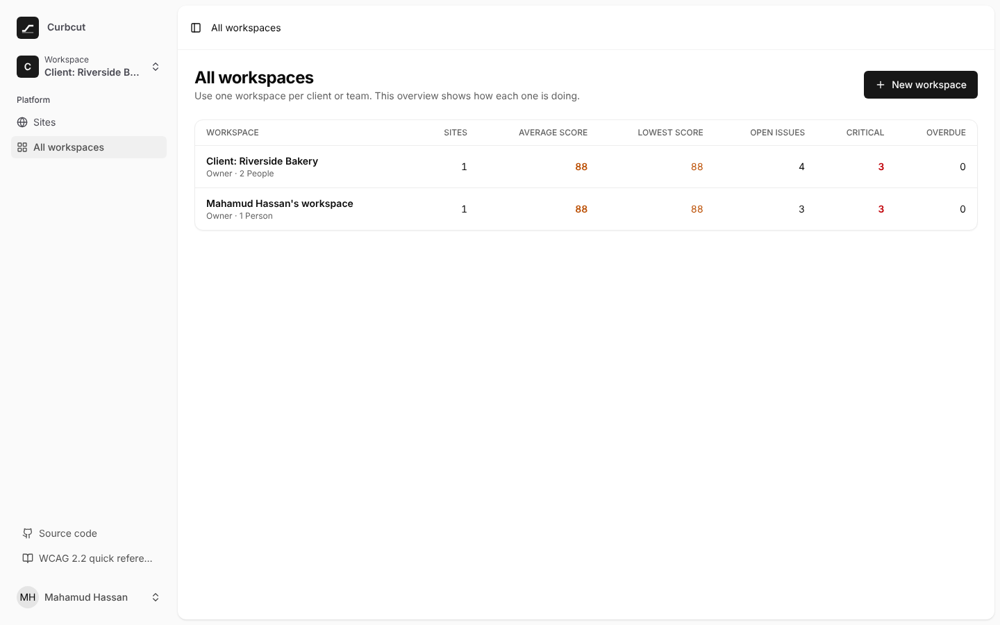
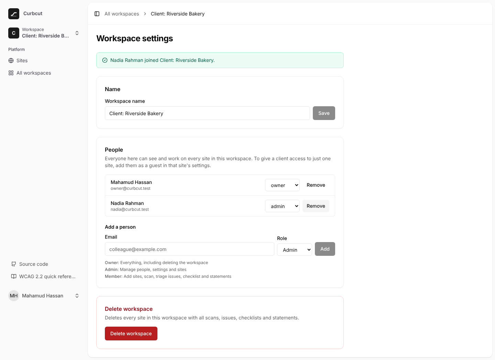
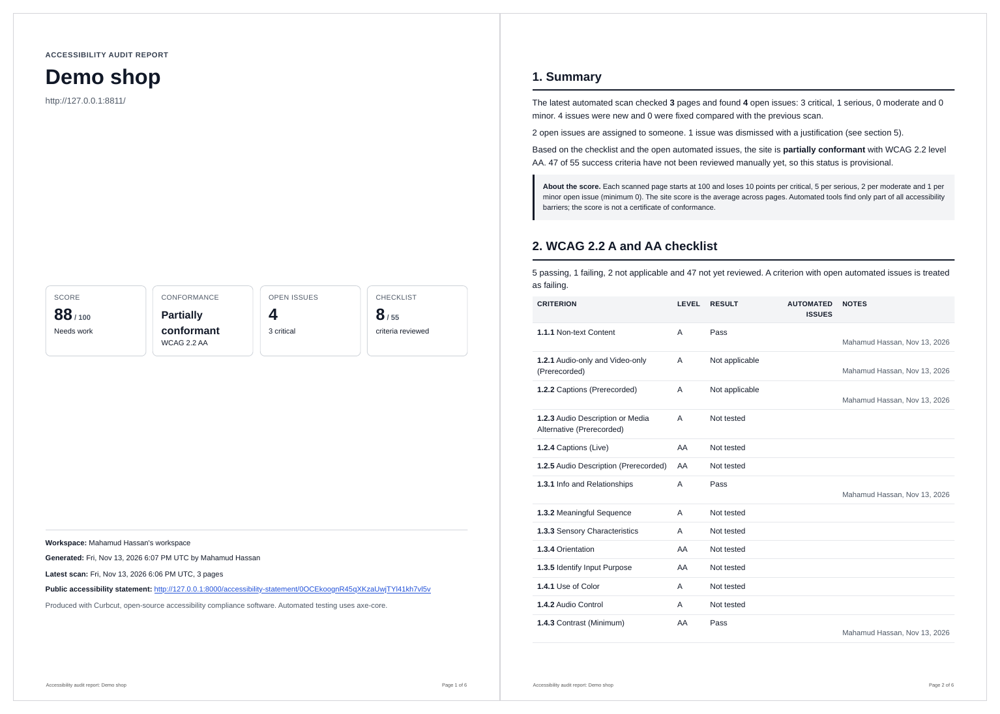

# User guide

This guide walks through Curbcut from adding a first site to handing a client a PDF audit report.

- [Workspaces](#workspaces)
- [Sites and scans](#sites-and-scans)
- [Issues](#issues)
- [The WCAG checklist](#the-wcag-checklist)
- [Accessibility statement](#accessibility-statement)
- [Audit reports (PDF)](#audit-reports-pdf)
- [Activity history](#activity-history)

## Workspaces

A workspace holds a group of sites and the people who work on them. Use one per team, department or, for agencies, one per client.

Everyone starts with a personal workspace. Create more from the workspace menu at the top of the sidebar, or from **All workspaces**. The same menu switches between them; the site list always shows the sites of the workspace you are in.

**All workspaces** is an overview of every workspace you belong to: the number of sites, the average and lowest score, open and critical issues, and overdue assignments. Agencies can see at a glance which client needs attention.

### Roles

Add people to a workspace from **Workspace settings** by email address. They need a Curbcut account first.

| | Owner | Admin | Member |
| --- | :-: | :-: | :-: |
| See and work on every site in the workspace | ✓ | ✓ | ✓ |
| Add sites, run scans, assign and dismiss issues, edit the checklist and statement | ✓ | ✓ | ✓ |
| Delete sites, add guests to a site | ✓ | ✓ | |
| Rename the workspace, add and remove people | ✓ | ✓ | |
| Make someone an owner, delete the workspace | ✓ | | |

A workspace always keeps at least one owner. Anyone can leave a workspace from its settings page.

### Guests

Sometimes a person should see one site but not the whole workspace, for example a client's developer. Add them as a **guest** in that site's **Settings**. Guests can work on that site only; it shows up in their own site list marked "Shared with you".

## Sites and scans

Click **Add site**, enter a name and the start URL. Optionally:

- **Sitemap URL.** Curbcut reads it (sitemap indexes too) to find pages. Without one, it follows links from the start URL on the same domain.
- **Page limit.** How many pages to scan, up to the server's limit.
- **Schedule.** Manual, daily or weekly.

The first scan starts right away. Each page is opened in Chrome and checked with axe-core against WCAG 2.0, 2.1 and 2.2 at levels A and AA. The scan page shows progress live and, when it finishes, what is **new**, what is **fixed** and which pages failed to load.

### The score

Each page starts at 100 and loses 10 points per critical, 5 per serious, 2 per moderate and 1 per minor open issue, down to 0. The site score is the average across pages. Dismissed issues don't count.

Automated tools find only part of the accessibility problems on a site. The score measures progress on what machines can detect; the [checklist](#the-wcag-checklist) covers the rest.

## Issues

**Issues** lists every problem found, grouped by rule (for example "Images must have alternate text") or by page. Filter by impact, status, page, assignee, WCAG criterion or text.

Open an issue to see the failing element, its HTML, what axe-core reported, how to fix it and the WCAG success criterion it breaks.

### Working on issues

- **Assign** an issue to someone and set a due date. They get an email (if mail is configured).
- **Bulk actions:** tick several issues, or a whole group, and assign or dismiss them together.
- **Comment** to discuss a fix with your team.
- **Dismiss** an issue that is a false positive or an accepted risk. A reason is required. Dismissed issues stay dismissed on later scans and are listed separately in reports.

You don't close issues by hand. When a later scan no longer finds the problem, Curbcut marks it **fixed**. If it comes back later, it reopens and counts as new in that scan.

## The WCAG checklist

Machines catch roughly a third of accessibility problems. The checklist covers all 55 WCAG 2.2 success criteria at levels A and AA so that people can review the rest: keyboard use, meaningful alternative text, captions, focus order and so on.

For each criterion, mark **pass**, **fail** or **not applicable**, and add notes and evidence. Curbcut records who reviewed it and when, links the W3C "Understanding" page and shows any open automated issues for that criterion. A criterion with open automated issues counts as failing even if it is marked as passing.

## Accessibility statement

Many laws, including the European Accessibility Act and the EU Web Accessibility Directive, require a public accessibility statement. Curbcut drafts one from the checklist and the latest scan, following the structure of the EU model statement:

- conformance status (fully, partially or not conformant, suggested from your data)
- known limitations and alternatives
- how to give feedback and who to contact
- the enforcement procedure
- how the site was assessed and when

Edit any section, then **Publish** to get a public link. The public page updates itself as the checklist and scans change. You can unpublish it at any time.

## Audit reports (PDF)

Click **Audit report (PDF)** on any site to download a report you can send to a client, a manager or an auditor. It contains:

1. A cover page with the score, conformance status, open issues and checklist progress
2. A summary: what was tested, how, the score history and issues by impact
3. The WCAG 2.2 checklist results, criterion by criterion
4. Open problems grouped by rule, with affected pages, the WCAG criterion and how to fix them
5. The pages with the most open issues
6. Dismissed issues with their reasons
7. A short audit trail of recent activity

The PDF is tagged, with headings, bookmarks and reading order, so it is accessible to screen reader users too. Every download is recorded in the site's activity history.

## Activity history

Every assignment, dismissal, comment, checklist change, statement change and report download is recorded with who did it and when. Recent activity appears on the site overview and on each issue, and the audit report includes it.
